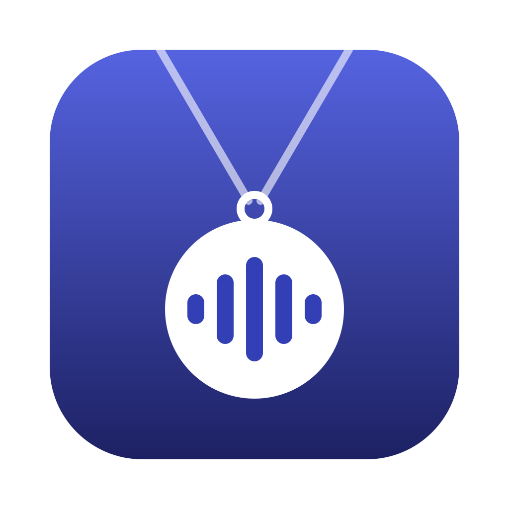
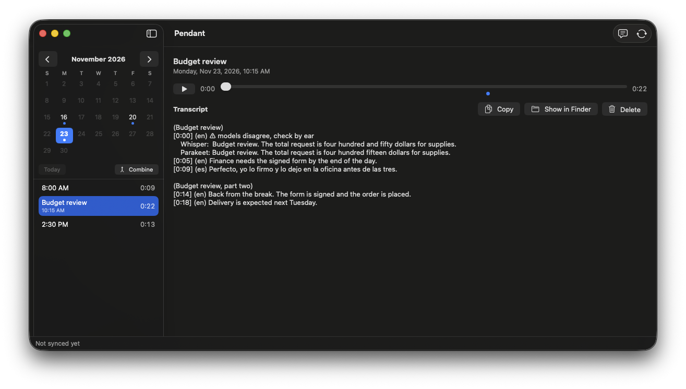
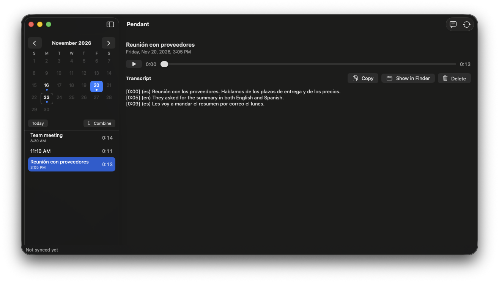
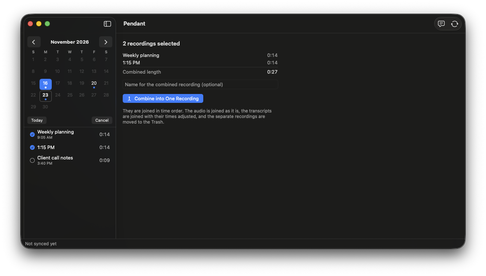

# Pendant: a Mac app for the Limitless pendant

A Mac app that keeps a Limitless pendant useful without the Limitless service. It downloads recordings from the pendant over Bluetooth, saves the audio on your Mac, and transcribes it on your Mac with two speech models. Nothing is sent to a server.

This is an unofficial hobby project. It is not affiliated with, endorsed by, or supported by Limitless or Meta.

It was built in conversation with [Claude Code](https://claude.com/claude-code), Anthropic's coding assistant: the code and this README were written by Claude, directed and tested by the repository owner on their own pendant.



## What it looks like

These screenshots use the made-up sample recordings from `tools/make_demo.py`, not real conversations.

**A day's recordings, the player and a transcript.** The calendar marks days that have recordings. This recording was combined from two parts: the dot under the playback bar marks where they meet, and the ⚠ line shows a passage where the two speech models disagreed.



**English and Spanish in the same recording.** Each line is labelled with the language that was detected.



**Combining recordings.** Press Combine, tick the recordings to join, and optionally name the result.



## Status

It works on one person's setup: a pendant on firmware 1.1.20 and an M4 MacBook Air running macOS 26. It has not been tested on other firmware versions, Intel Macs, or older macOS releases. Expect rough edges.

## What it does

- **Sync:** connects to the pendant over Bluetooth, downloads everything stored on it, and stops by itself once it has caught up.
- **Library:** a calendar marks the days that have recordings; pick a day to see its recordings, with a player.
- **Organise:** name recordings, combine several into one, and move a late-night recording to the day before.
- **Transcription:** runs in the background at low priority after each sync. Each recording is transcribed by Whisper large-v3 and by Parakeet v3, and passages where the two disagree are marked so you can check them by ear.
- **English and Spanish:** the language is detected for each short piece of audio, so a conversation that moves between languages is transcribed in each. Whisper supports many more languages; only English and Spanish have been tried.
- **Plain files:** every transcript is a text file, and each day also gets one Markdown file, easy to paste into a chat assistant or read with any tool.
- **Delete:** moves a recording and its transcript to the Trash.

## Before you start

- **Syncing removes audio from the pendant.** Each piece is deleted from the pendant once your Mac has received it. The copy on your Mac is then the only one, so back up the `Library` folder if the recordings matter to you.
- **Do not update the pendant's firmware.** The Bluetooth client this app relies on was written for firmware 1.1.20.
- **The pendant pairs with one device at a time.** Once it is paired with your Mac, the Limitless phone app will no longer connect to it unless you pair it there again.
- **It is an always-on microphone.** Recording other people may require their consent where you live. Tell the people around you.

## What you need

- A Mac with Apple silicon (M1 or newer), macOS 14 or later.
- About 6 GB of free disk space (3.4 GB of that is the speech models).
- Apple's Command Line Tools. Install them by running `xcode-select --install` in Terminal. Full Xcode is not needed.
- [Homebrew](https://brew.sh).
- A Limitless pendant, charged and nearby.

## Install

Open the Terminal app and run these one at a time:

```bash
git clone https://github.com/quiroz-xyz/pendant-mac.git
```

```bash
cd pendant-mac
```

```bash
./setup.sh
```

`setup.sh` installs Python 3.12 and Opus with Homebrew, downloads [pendant-cli](https://github.com/MAkcanca/pendant-cli) into a `vendor` folder, creates a private Python environment in `runtime`, builds the app, and copies it into your Applications folder. The first build takes several minutes.

Pendant then appears in Applications, Launchpad and Spotlight like any other app. You can also open it from Terminal:

```bash
open -a Pendant
```

**Do not move or delete the `pendant-mac` folder after setup.** The app in Applications is only the window; the Python environment, the speech models and your recordings all live in that folder. If you do move it, run `./setup.sh` again from its new place.

To remove everything, drag Pendant from Applications to the Trash and delete the `pendant-mac` folder (back up its `Library` folder first if you want to keep your recordings).

## Try it without a pendant

To see how the app looks and works before syncing anything, you can load a sample library of made-up recordings. The audio is computer-generated speech reading made-up meeting notes in English and Spanish.

```bash
runtime/venv/bin/python tools/make_demo.py
```

```bash
open -a Pendant --args -libraryPath "$PWD/demo/Library" -transcriptionPaused YES
```

Quit Pendant first if it is already open. The sample library lives in a `demo` folder and does not touch your own recordings; opening Pendant normally goes back to your own library.

## First sync

1. Open the app and press **Sync**. macOS asks whether Pendant may use Bluetooth; allow it.
2. The app looks for the pendant, connects, and downloads. The bar at the bottom shows progress and the pendant's battery level.
3. The first transcription downloads the two speech models (about 3.4 GB), which can take a while. After that, transcripts appear a few minutes after each sync.

### If the sync fails with "Insufficient Encryption"

The pendant is still paired with another device, usually the phone that ran the Limitless app. There are two ways to clear that:

- **Factory reset with the button.** This is Limitless's documented method, and it erases recordings that have not been synced. Unplug the pendant, press and release the button, then press and hold it until the purple light goes out. A blue light means it is ready to pair.
- **Unpair over USB.** This kept the stored recordings on the pendant it was tried on, but it is not documented by Limitless and has been tried on exactly one pendant. Plug the pendant into the Mac with a cable that carries data, then run:

```bash
python3 tools/pendant_usb.py "ble unpair"
```

Then press **Sync** again.

## Using it

**Syncing and transcribing**

- **Sync** downloads new recordings. Sync often: Bluetooth is slow, so a long backlog takes a long time.
- **Transcribe** (toolbar toggle) pauses or resumes background transcription.
- A clock icon marks recordings waiting to be transcribed; a spinner marks the one in progress.
- The bar at the bottom shows what the app is doing and the pendant's battery level.

**Finding recordings**

- The calendar on the left shows a dot under each day that has recordings. Click a day to list its recordings.
- **Today** jumps back to today.

**Working with a recording**

- **Copy** copies its transcript. **Show in Finder** reveals the audio file. **Delete** moves it to the Trash.
- Double-click a recording's name, in the list or in the title, to rename it. Return saves, Escape cancels.
- Right-click a recording for **Move to Previous Day** and **Move to Next Day**. The recording keeps its real time and is listed under the other day, which suits a session that ran past midnight.
- **Control-Delete** or **Command-Delete** moves the selected recording to the Trash straight away. The Delete key asks first.
- To redo a transcript, delete the recording's `.txt` file in Finder; the app queues it again.

**Combining recordings**

- Click **Combine** under the calendar, tick two or more recordings from that day, optionally give the result a name, and press **Combine into One Recording**.
- The audio is joined in time order without re-encoding. The transcripts are joined with their times adjusted. The separate recordings go to the Trash.
- A dot under the playback bar marks each place where two parts meet. Click a dot to jump there.

**Copying several transcripts**

- Select several recordings with Shift-click or Command-click (Command-A selects the whole day), right-click, and choose **Copy N Transcripts**.
- Right-click a day in the calendar and choose **Copy This Day's Transcripts** to copy everything from that day.

## Where your files are

Everything stays inside the project folder:

| Path | Contents |
|---|---|
| `Library/audio/DATE/` | One `.opus` audio file per recording, with its transcript (`.txt`) and details (`.json`, `.transcript.json`) beside it |
| `Library/transcripts/DATE.md` | One Markdown file per day with all of that day's transcripts |
| `Library/raw/` | Raw sync journals, kept for 14 days as a safety copy |
| `Models/` | The downloaded speech models |

The `.opus` files play in most browsers and in VLC. QuickTime does not open them.

## How it works

```
Pendant ──Bluetooth──▶ pendant-cli ──▶ pendant_drain.py ──▶ Library/audio/*.opus
                                                                   │
                              Whisper large-v3 + Parakeet v3  ◀────┘
                                          │
                                          ▼
                         transcript .txt + daily Markdown  ──▶  the app
```

- **The app** (`PendantApp/Sources/PendantApp`) is written in Swift with SwiftUI. It shows the library, plays audio, and starts the two helpers below.
- **Sync** (`PendantApp/Support/pendant_drain.py`) is a Python script built on pendant-cli, which speaks the pendant's Bluetooth protocol. The script writes every message to a journal file on disk the moment it arrives, because the pendant deletes each piece once it is acknowledged. If a sync is interrupted, the next one recovers what was already received. It stops when it receives audio recorded after the sync began, since a pendant that is recording never goes idle. It then joins continuous audio into recordings; a pause of more than 30 seconds starts a new one.
- **Transcription** (`PendantApp/Sources/PendantTranscribe`) is a separate Swift command-line tool that the app runs at background priority. It cuts the audio at pauses into pieces of at most 28 seconds, transcribes each piece with both models, compares the two results word by word, and marks pieces where they agree on less than 60% of the words. Pieces with no speech are left out.

- **Combining** is done by the same Python script: it copies the Opus packets from each file into one new Ogg Opus file, so nothing is re-encoded.

The app icon is drawn in `PendantApp/Support/AppIcon.svg`; `swift tools/make_icon.swift` turns it into the `.icns` file the app uses.

The pendant's USB port is also a serial command shell. `tools/pendant_usb.py` sends commands to it. Some of those commands erase recordings or rewrite storage, so only send ones you understand.

## Known limits

- A recording that is still in progress when a sync ends shows up as two entries. Combine can join them afterwards.
- Transcripts do not say who is speaking.
- If speakers switch language without pausing, words can be lost, because each piece of audio is treated as one language.
- Background music is transcribed badly and produces many "models disagree" marks.
- There are no settings yet for storage limits or automatic clean-up of old audio.
- The app is built on your own Mac and is not signed with an Apple developer certificate. There is no ready-made download.

## Credits

This project stands on other people's work:

| Project | Used for | Licence |
|---|---|---|
| [pendant-cli](https://github.com/MAkcanca/pendant-cli) by Mustafa Akcanca | The Bluetooth client for the pendant. All of the protocol work is theirs. It is downloaded by `setup.sh` and is not included in this repository. | MIT |
| [pendant-sync](https://github.com/aldrinjenson/pendant-sync) by Aldrin Jenson | The project that showed this could be done on a Mac, and the model for the sync, transcribe, daily Markdown pipeline. See their [write-up](https://aldrinjenson.com/posts/limitless-pendant-second-life/). | MIT |
| [WhisperKit](https://github.com/argmaxinc/WhisperKit) by Argmax | Runs Whisper on Apple silicon | MIT |
| [FluidAudio](https://github.com/FluidInference/FluidAudio) by Fluid Inference | Runs Parakeet on Apple silicon | Apache 2.0 |
| Whisper large-v3 by OpenAI | Speech model, downloaded on first use | See the model's page |
| Parakeet TDT 0.6B v3 by NVIDIA | Speech model, downloaded on first use | See the model's page |
| [Bleak](https://github.com/hbldh/bleak) | Bluetooth library used by pendant-cli | MIT |

Built with [Claude Code](https://claude.com/claude-code).

## Licence

The code in this repository is released under the MIT licence; see [LICENSE](LICENSE). The projects and models listed above keep their own licences.

"Limitless" is a trademark of its owner and is used here only to say which device this works with.
